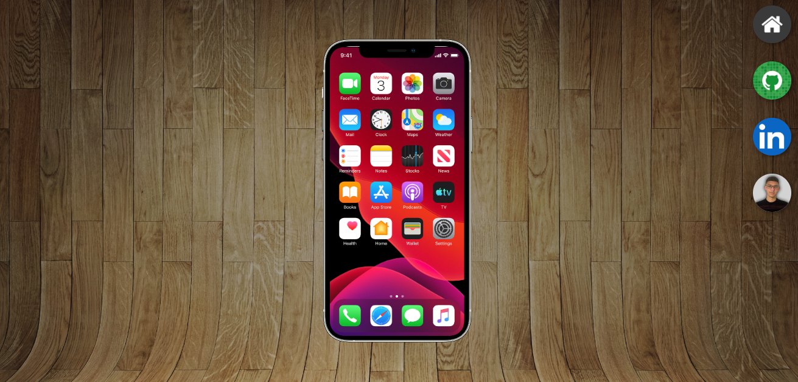
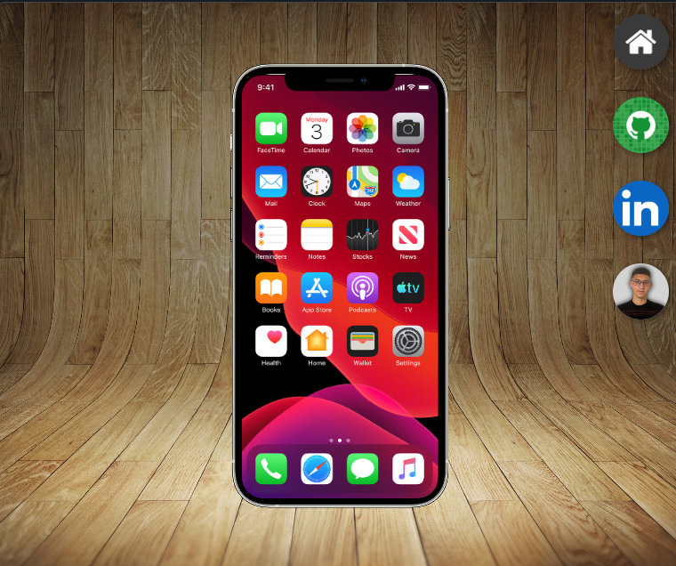
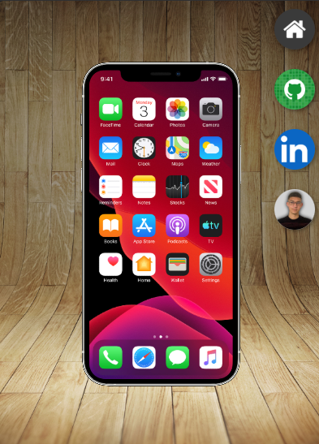

# Tela de Redes Sociais — Interface com Smartphone

Página front-end que apresenta uma interface de smartphone sobre um cenário de madeira. Os ícones laterais alteram o conteúdo exibido dentro da tela, permitindo navegar entre meu GitHub, LinkedIn e portfólio.

## Capturas de tela

| Desktop | Tablet | Mobile |
|:---:|:---:|:---:|
|  |  |  |

## Demonstração

[Acessar o projeto no GitHub Pages](https://devaxl64.github.io/Tela_Redes-Sociais/)

## Funcionalidades e técnicas

- Navegação visual por ícones de redes sociais.
- Troca de páginas dentro de um `iframe` que simula a tela de um celular.
- Acesso aos perfis externos pelos links exibidos nas páginas.
- Estilização com CSS, posicionamento e efeitos de hover.
- Interface montada com HTML e CSS, sem JavaScript.

## Executar localmente

Abra `index.html` no navegador, mantendo as pastas `css` e `images` e as demais páginas HTML no mesmo projeto.

## Origem

Projeto feito durante o curso de **HTML5 e CSS3 do Curso em Vídeo, com Gustavo Guanabara**. Utilizei os conceitos aprendidos nas aulas e realizei adaptações de imagens, links e apresentação visual.

## Autor

**Axel Castro — devaxl64**  
[GitHub](https://github.com/devaxl64) · [LinkedIn](https://www.linkedin.com/in/marcellaxel/) · [Portfólio](https://devaxl64.github.io/Portif-lio/)
